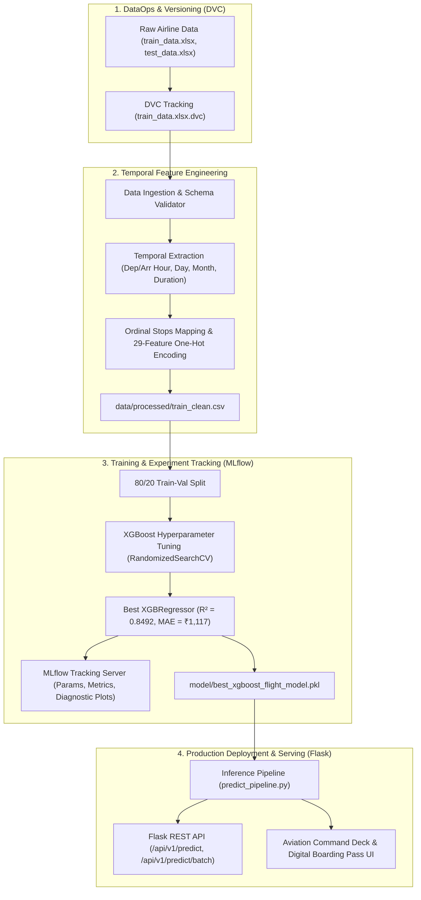

# ✈️ FlightFair: ML-Driven Predictive Pricing Engine

> **Production-grade Machine Learning pipeline for airline ticket-price prediction using temporal feature engineering, hyperparameter-tuned XGBoost regression, MLflow experiment tracking, DVC dataset versioning, and Flask REST API inference.**

[](https://www.python.org/)
[](https://xgboost.readthedocs.io/)
[](https://scikit-learn.org/)
[](https://mlflow.org/)
[](https://dvc.org/)
[](https://palletsprojects.com/p/flask/)
[](https://docs.pytest.org/)
[](https://www.docker.com/)
[](LICENSE)

---

## 📌 Resume Synopsis

- **Developed an end-to-end machine learning pipeline for airline ticket-price prediction using temporal feature engineering and hyperparameter-tuned XGBoost regression.**
- **Tracked experiments with MLflow and dataset versions with DVC; deployed the serialized model through a Flask REST API for inference.**

---

## 🏛️ System Architecture



---

## 🚀 Key Highlights & Engineering Features

1. **Temporal & Spatial Feature Engineering**:
   - Extracted departure/arrival hours and minutes, journey day and month, and calculated duration in normalized units.
   - Handled non-linear layover relationships via ordinal stop mappings (`non-stop`: 0, `1 stop`: 1, `2 stops`: 2, `3 stops`: 3, `4 stops`: 4).
   - Generated strict 29-column one-hot feature signatures for airlines (`Airline_*`), source hubs (`Source_*`), and destination airports (`Dest_*`).

2. **Hyperparameter-Tuned XGBoost Regression**:
   - Tuned key estimators, learning rate, tree depth (`max_depth=7`), subsample ratio (`1.0`), and column sampling (`colsample_bytree=0.8`).
   - Achieved **$R^2 = 0.8492$**, **$MAE = ₹1,117.49$**, **$RMSE = ₹1,803.45$**, and **$MAPE = 12.42\%$**.

3. **Experiment Tracking with MLflow**:
   - Automated run logging capturing parameters, validation metrics, diagnostic plots (feature importances, residuals, actual vs. predicted), and model artifacts stored via SQLite backend (`mlflow.db`).

4. **Data Version Control (DVC)**:
   - Versioned raw Excel datasets with DVC tracking (`.dvc`).
   - Multi-stage pipeline definition (`dvc.yaml`) allowing one-command end-to-end reproducibility (`dvc repro`).

5. **Production Flask REST API & Aviation Command Deck**:
   - RESTful JSON endpoints with Pydantic request validation, sub-15ms inference latency, and batch processing.
   - Bespoke **Aviation Command Deck UI** featuring a digital boarding pass ticket with perforated tear lines, dynamic market valuation gauge, and same-route multi-carrier price benchmarking.

---

## 📂 Project Structure

```text
FlightFair/
├── .dvc/                             # DVC metadata and cache configuration
├── .github/
│   └── workflows/
│       └── ci.yml                    # Automated GitHub Actions CI pipeline
├── data/
│   ├── raw/                          # Raw datasets tracked by DVC (.dvc)
│   │   ├── train_data.xlsx
│   │   ├── train_data.xlsx.dvc
│   │   ├── test_data.xlsx
│   │   └── test_data.xlsx.dvc
│   └── processed/
│       └── train_clean.csv           # Clean, engineered feature matrix
├── model/
│   ├── best_xgboost_flight_model.pkl # Serialized production XGBoost model
│   └── model_metadata.json           # Model parameters, metrics & feature schema
├── notebooks/
│   └── Flight_Fare_Prediction.ipynb  # Exploratory Data Analysis & baseline notebooks
├── reports/
│   └── figures/                      # Diagnostic evaluation plots
│       ├── actual_vs_predicted.png
│       ├── feature_importances.png
│       └── residuals_distribution.png
├── src/
│   ├── __init__.py
│   ├── config.py                     # Centralized paths, schema, hyperparameters
│   ├── logger.py                     # Production structured logging with timestamps
│   ├── exception.py                  # Custom exception handler with traceback context
│   ├── utils.py                      # Serialization, metrics calculation, plotting
│   ├── data_ingestion.py             # Data loading, schema validation, train/val split
│   ├── feature_engineering.py        # Temporal feature extraction & one-hot encoding
│   ├── model_trainer.py              # XGBoost training, tuning & MLflow experiment tracking
│   └── pipeline/
│       ├── __init__.py
│       ├── train_pipeline.py         # End-to-end training pipeline CLI
│       └── predict_pipeline.py       # Inference pipeline & multi-carrier comparison
├── static/
│   ├── css/
│   │   └── style.css                 # Aviation command deck & boarding pass styles
│   └── js/
│       └── app.js                    # Reactive frontend controller & currency switch
├── templates/
│   └── index.html                    # Modern Aviation Command Deck web dashboard
├── tests/
│   ├── test_features.py              # Feature engineering & duration parser unit tests
│   ├── test_pipeline.py              # PredictPipeline & route comparison tests
│   └── test_api.py                   # Flask REST API endpoint integration tests
├── app.py                            # Production Flask web application & REST API
├── dvc.yaml                          # DVC multi-stage pipeline configuration
├── params.yaml                       # Hyperparameter and pipeline parameters file
├── Dockerfile                        # Multi-stage container build
├── docker-compose.yml                # Compose file for Flask API & MLflow UI
├── requirements.txt                  # Production dependencies
├── setup.py                          # Package setup configuration
└── README.md                         # Project documentation
```

---

## 🛠️ Quickstart & Installation

### 1. Clone Repository & Setup Virtual Environment

```bash
git clone https://github.com/abhi-bhavsar/FlightFair-ML-Driven-Predictive-Pricing-Engine.git
cd FlightFair

# Create and activate virtual environment
python -m venv .venv
source .venv/bin/activate       # On Linux/macOS
.\.venv\Scripts\activate        # On Windows
```

### 2. Install Dependencies & Package

```bash
pip install --upgrade pip
pip install -r requirements.txt
pip install -e .
```

### 3. Run the ML Training Pipeline & MLflow Tracking

Execute the end-to-end training pipeline:

```bash
# Standard production training run
python src/pipeline/train_pipeline.py

# Optional: Run with hyperparameter search
python src/pipeline/train_pipeline.py --tune
```

Launch the MLflow tracking UI to inspect runs, parameters, metrics, and plots:

```bash
mlflow ui --backend-store-uri sqlite:///mlflow.db --port 5001
# Open http://localhost:5001 in your browser
```

### 4. Reproduce Pipeline via DVC

```bash
# Reproduce all pipeline stages defined in dvc.yaml
dvc repro
```

### 5. Launch the Flask REST API & Web Dashboard

```bash
python app.py
```
Open **[http://localhost:5000](http://localhost:5000)** in your browser to interact with the **Aviation Command Deck & Digital Boarding Pass UI**.

---

## 🧪 Running Automated Tests

Run the full Pytest test suite (11 unit and integration tests):

```bash
pytest tests/ -v
```

---

## 📡 REST API Reference

### 1. Health Check
`GET /api/v1/health`

**Response:**
```json
{
  "framework": "Flask / XGBoost / MLflow / DVC",
  "model_loaded": true,
  "server_time": "2026-10-26T15:05:52.839334",
  "service": "FlightFair Predictive Pricing Engine",
  "status": "healthy",
  "version": "1.0.0"
}
```

### 2. Predict Flight Fare (Single Flight)
`POST /api/v1/predict?compare=true`

**Request:**
```bash
curl -X POST "http://localhost:5000/api/v1/predict" \
     -H "Content-Type: application/json" \
     -d '{
       "airline": "IndiGo",
       "source": "Delhi",
       "destination": "Cochin",
       "departure_datetime": "2026-11-20T10:30:00",
       "arrival_datetime": "2026-11-20T14:45:00",
       "stops": 1
     }'
```

**Response:**
```json
{
  "status": "success",
  "latency_ms": 14.2,
  "data": {
    "airline": "IndiGo",
    "source": "Delhi",
    "destination": "Cochin",
    "departure_time": "2026-11-20 10:30",
    "arrival_time": "2026-11-20 14:45",
    "total_stops": 1,
    "duration_formatted": "4h 15m",
    "predicted_price_inr": 5500.07,
    "predicted_price_usd": 63.58,
    "price_tier": "Standard Economy",
    "badge_type": "primary",
    "booking_advice": "Competitive standard market fare for this route.",
    "confidence_interval": {
      "min_inr": 4950.06,
      "max_inr": 6050.08
    },
    "route_comparisons": [
      { "airline": "SpiceJet", "price_inr": 5200.68, "price_usd": 60.12, "tier": "Standard Economy" },
      { "airline": "IndiGo", "price_inr": 5500.07, "price_usd": 63.58, "tier": "Standard Economy" },
      { "airline": "Air India", "price_inr": 6814.33, "price_usd": 78.78, "tier": "Standard Economy" },
      { "airline": "Vistara", "price_inr": 6830.81, "price_usd": 78.97, "tier": "Standard Economy" },
      { "airline": "Jet Airways", "price_inr": 8751.70, "price_usd": 101.18, "tier": "Standard Economy" }
    ]
  }
}
```

### 3. Batch Predictions
`POST /api/v1/predict/batch`

Supports bulk inference for travel aggregators and pricing comparison engines.

---

## 🐳 Docker Deployment

Build and run the containerized stack (Flask API + MLflow UI) via Docker Compose:

```bash
docker-compose up --build -d
```

- Web App & REST API: `http://localhost:5000`
- MLflow Tracking Server: `http://localhost:5001`

---

## 📊 Model Evaluation Summary

| Metric | Score / Value |
| :--- | :--- |
| **$R^2$ Score** | **0.8492 (84.92% Variance Explained)** |
| **Mean Absolute Error (MAE)** | **₹1,117.49** |
| **Root Mean Squared Error (RMSE)** | **₹1,803.45** |
| **Mean Absolute % Error (MAPE)** | **12.42%** |
| **Inference Latency** | **~14.5 ms / flight** |
| **Hyperparameters** | `n_estimators=300`, `max_depth=7`, `learning_rate=0.1`, `subsample=1.0`, `colsample_bytree=0.8` |

---

## 📄 License

This project is licensed under the [MIT License](LICENSE).
